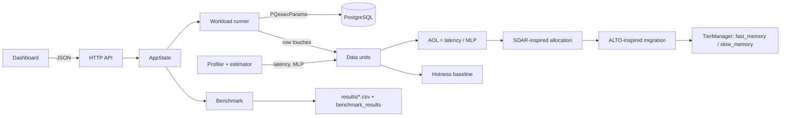

# Architecture

## 1. Diagram

```
                ┌──────────────────────────── Browser (frontend/) ────────────────────────────┐
                │ Overview · Database · Workload · Profiling · Placement · Migrations · Bench │
                └───────────────────────────────┬─────────────────────────────────────────────┘
                                                │ HTTP/JSON, 127.0.0.1 only
┌───────────────────────────────────── memopt.exe (C++17) ─────────────────────────────────────┐
│  api/http_server ──► api/api (routing, validation) ──► api/app (AppState: shared operations) │
│                                                                    │                          │
│   ┌───────────── dbms ─────────────┐   ┌──── profiling ────┐       │      ┌── results ──┐     │
│   │ postgres (libpq, PQexecParams) │   │ IProfiler         │       │      │ CSV writer  │     │
│   │ workload runner + query library│   │  ├ LinuxPerf      │       │      │ DB inserts  │     │
│   │ dataset: 34 data units         │   │  └ Fallback       │       │      └─────────────┘     │
│   │ AccessTracker (row touches)    │   │ UnitMetricEstimator│      │                          │
│   └───────────────┬────────────────┘   └────────┬──────────┘       │                          │
│      access counts│               latency, MLP  │                  │                          │
│                   ▼                             ▼                  │                          │
│               ┌──────────────── aol: AOL = latency / MLP ─────────────────┐                   │
│               └───────────┬───────────────────────────────┬───────────────┘                   │
│                           ▼                               ▼                                   │
│        hotness (rank by accesses)          soar (rank by accesses × AOL) → alto (migrate)      │
│                           └───────────────┬───────────────┘                                   │
│                                           ▼                                                   │
│                    benchmark (epochs, same SQL)      tiering/TierManager                      │
│                                                       fast_memory/  slow_memory/  manifest     │
└──────────────────────────────────────────┬────────────────────────────────────────────────────┘
                                           │ libpq
                               ┌───────────▼───────────┐
                               │ PostgreSQL memopt_demo│ users, products, orders, transactions
                               │                       │ + workload_runs, query_metrics, ...
                               └───────────────────────┘
```

Same flow in Mermaid (renders on GitHub):



## 2. Data units

A **data unit** is a fixed primary-key range of one demo table — the stand-in for the paper's pages/objects:

| Table | Rows | Unit size | Units |
|---|---|---|---|
| users | 5,000 | 500 | `users_s00` … `users_s09` |
| products | 2,000 | 500 | `products_s00` … `products_s03` |
| orders | 20,000 | 2,000 | `orders_s00` … `orders_s09` |
| transactions | 20,000 | 2,000 | `transactions_s00` … `transactions_s09` |

Data units are **synthetic page identifiers over real records**: the rows exist in PostgreSQL, but MemOpt does not control where PostgreSQL stores them.

**Access counting.** Every executed query attributes *row touches* to units, tagged with a pattern:

- the key range a query scans (`BETWEEN $1 AND $2`) → **sequential** touches;
- a point lookup key → **random** touches; keys returned in `user_id`, `product_id`, `txn_id` columns of joins are attributed too;
- lookups from the small skewed “popular” key set → **repeated** touches.

Aggregates that do not return keys only count their declared range (documented in `workload.sql`).

## 3. Workloads (`workloads/workload.sql`, `src/dbms/workload.cpp`)

| Type | Per repetition | SQL features |
|---|---|---|
| sequential | 12 range scans of 100 rows (orders, transactions) + 1 aggregate over 400 orders | WHERE, ORDER BY, GROUP BY, COUNT/SUM |
| random | 300 user lookups + 300 order lookups (join with products) | indexed lookups, JOIN |
| popular | 200 lookups over 20 hot products + 150 over 15 hot users (skewed) | repeated queries |
| mixed | all of the above + 1 four-table join + 1 revenue aggregate | everything |

Parameters come from `std::mt19937` with a fixed seed and a portable mapping, so Windows and Linux run identical queries. The `epoch` argument shifts the random-lookup region (users by 500 keys, orders by 2,000 keys) to create workload phases for the migration controller.

Timing: `std::chrono::steady_clock` around each `PQexecParams` call → client-observed round trip. Warm-up runs are executed but not recorded.

## 4. Metrics and AOL

`UnitMetricEstimator` (`src/profiling/unit_metrics.cpp`):

- `fallback` mode — latency = `MEMOPT_BASE_LATENCY_NS` ± 10 % deterministic jitter, labelled **synthetic**; MLP = weighted harmonic mean of the assumed per-pattern MLP (48 sequential, 9 random, 20 repeated) using the **measured** pattern mix, labelled **estimated**.
- `measured` mode — both are **unavailable** unless a profiler can attribute latency/MLP to units (none in this prototype). Placement then refuses with HTTP 409 instead of guessing.

`AOLCalculator` (`src/aol/aol.cpp`): `AOL = latency / MLP`, with validation (missing, NaN/inf, latency outside 1–100,000 ns, MLP < 1 or > 1000, MLP = 0). The result's label is the *weakest* input label.

**How AOL affects placement.** AOL ≈ stall time per access. A unit with high AOL hurts more when it is slow; a unit with low AOL (prefetch-friendly scans) hides latency, so it can stay in SLOW even if it is hot.

## 5. Policies

**Hotness baseline** (`src/hotness`) — rank by access count, top `MEMOPT_FAST_CAPACITY` units → FAST. Re-rank every epoch with no hysteresis.

**SOAR-inspired allocation** (`src/soar`) — `AOLRankingPolicy` priority = `accesses × AOL` (estimated stall contribution). Top-N by priority → FAST, same capacity as the baseline. Every decision has a rank and a reason.

**ALTO-inspired migration** (`src/alto`) — after each epoch:

1. preference: AOL > 7 → FAST, AOL < 3 → SLOW, otherwise keep (dead band); FAST units with no accesses → SLOW (idle);
2. preference must persist `confirm_epochs`; a unit that moved is frozen for `cooldown_epochs`;
3. demotions first, then promotions in order of stall priority;
4. if FAST is full, a promotion may evict the FAST unit with the lowest priority only if the candidate's priority is ≥ (1 + `swap_margin`) × the victim's;
5. `dry_run` records decisions without changing the placement.

## 6. Tiers (`src/tiering/tier_manager.cpp`)

`fast_memory/<unit>.unit` and `slow_memory/<unit>.unit` are small text placeholders; `tier_manifest.csv` lists the current location. Unit ids are whitelisted (`[A-Za-z0-9_-]`, ≤ 40 chars), files are written via temp-file + rename, moves use `rename`, existing files are never overwritten. The dashboard's live placement is stored here; the benchmark simulates placements in memory and never touches the folders.

## 7. Benchmark (`src/benchmark/benchmark.cpp`)

1. shared warm-up;
2. for each policy (hotness, then MemOpt): start with all units SLOW, run `epochs` × the mixed workload (`repetitions` each, same seeds for both policies);
3. after epoch 0 → initial allocation; after later epochs → migration; the placement decided after epoch *k* is charged during epoch *k+1*;
4. simulated stall cost per epoch = Σ accesses × AOL × (1 in FAST, `slow_tier_penalty` in SLOW);
5. profiler counters are collected around each policy's run.

Results: `results/benchmark_<timestamp>.csv` and `benchmark_results` / `migration_history` tables.

## 8. Database tables for results

`workload_runs` (one row per workload run) → `query_metrics` (per query name), `placement_decisions`, `migration_history`, `benchmark_results`. All inserts are parameterized; nothing is written when the connection is read-only.

## 9. Security choices

Server binds to 127.0.0.1 by default; no endpoint executes arbitrary SQL; all SQL parameters go through `PQexecParams`; request bodies are capped at 64 KB and validated; static files are served only from `frontend/` by plain file name; the password never leaves the process; CSV fields starting with `=`, `+`, `@` are prefixed to block spreadsheet formula injection.
